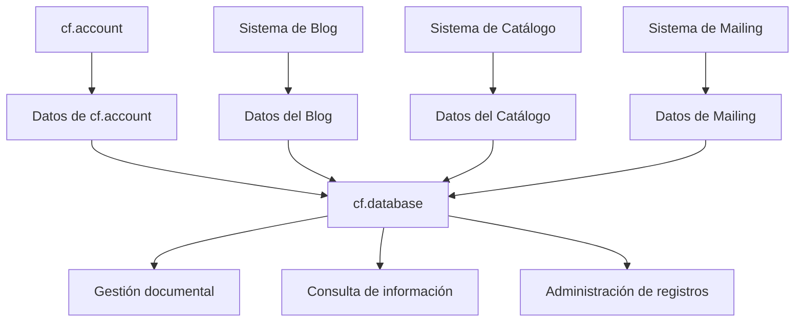

# Sistema de Base de Datos

`cf.database` es uno de los componentes centrales del [**proyecto trascender**](https://github.com/jotacalderon90/), encargado de centralizar la gestión de información utilizada por los distintos sistemas del ecosistema.

Su propósito es proporcionar una capa común para administrar información estructurada, permitiendo que aplicaciones como `cf.account` y futuros componentes de la plataforma puedan utilizar colecciones de datos sin implementar de manera independiente toda la lógica asociada a su administración.

Actualmente `cf.database` utiliza **MongoDB** como motor de persistencia. Sin embargo, su diseño considera como proyección futura la posibilidad de incorporar otros motores de base de datos, incluyendo bases de datos relacionales.

---

## Rol dentro del ecosistema

Dentro de **Trascender**, cada componente tiene una responsabilidad específica.

Mientras `cf.archivospublicos` administra recursos públicos, `cf.account` administra la identidad de los usuarios, `cf.archivosprivados` administra recursos privados, `cf.database` se encarga de la **información persistente del ecosistema**.

Este servicio busca convertirse en una capa común para:

* Centralizar información utilizada por múltiples sistemas
* Administrar colecciones de datos
* Definir estructuras de información reutilizables
* Facilitar la incorporación de nuevos tipos de información
* Proporcionar una base común para los demás componentes de la plataforma

De esta forma, los sistemas que forman parte de Trascender pueden apoyarse en una infraestructura común para visualizar y administrar información.

---

## Información administrada

`cf.database` está diseñado para administrar diferentes tipos de información mediante definiciones específicas.

Entre los datos que pueden formar parte del sistema se encuentran:

* Roles y estructuras utilizadas por `cf.account`
* Información asociada a cuentas de usuario
* Publicaciones de blog
* Catálogo de productos
* Información de correos enviados
* Registros y estructuras propias de otros sistemas
* Nuevos tipos de colecciones requeridos por la plataforma

La incorporación de un nuevo tipo de información debe realizarse mediante una **definición específica**, permitiendo que el sistema pueda extenderse sin modificar necesariamente su arquitectura principal.

---

## Capacidades

`cf.database` contempla capacidades relacionadas con:

* Administración de colecciones
* Definición de nuevos tipos de información
* Persistencia de documentos
* Consulta y administración de información

---

## Tecnologías

### Backend

* Node.js
* Express (a través de `cf.framework`)
* Zod (validaciones)
* MongoDB
* Node Cron
* Express FileUpload

### Dependencias principales

```json
{
  "zod": "4.4.3",
  "node-cron": "4.6.0",
  "express-fileupload": "1.5.2"
}
```

Las versiones indicadas corresponden a las dependencias consideradas actualmente para el proyecto.

---

### Servicio Docker referencial

```yaml
mongodb_service:
  image: mongo
  container_name: mongodb_service
  volumes:
    - ./_mongodb:/data/db
  ports:
    - "27017:27017"
  restart: always
```

---

## Integración con otros sistemas

`cf.database` no busca centralizar ni reemplazar la persistencia de los sistemas que forman parte de Trascender.

Su propósito es proporcionar, **de manera paralela**, una herramienta común para la **gestión y administración documental de la información almacenada por los diferentes sistemas del ecosistema**.

Conceptualmente, su función es similar a la relación existente entre **phpMyAdmin y una base de datos MySQL**: la aplicación continúa utilizando sus propios datos y lógica de negocio, mientras `cf.database` proporciona una interfaz especializada para administrar la información almacenada.

De esta forma, diferentes sistemas pueden mantener sus propias estructuras de información y, al mismo tiempo, disponer de capacidades centralizadas para su administración documental.

Entre los posibles sistemas relacionados se encuentran:

* `cf.account`
* Sistemas de blog
* Sistemas de catálogo
* Sistemas de mailing
* Sistemas administrativos
* Nuevos componentes desarrollados sobre `cf.framework`

Por ejemplo, `cf.account` puede mantener y utilizar normalmente la información correspondiente a sus cuentas, roles y permisos, mientras `cf.database` permite administrar documentalmente las colecciones y registros asociados a dicha información.



La relación con los sistemas consumidores es, por tanto, **complementaria y paralela**, permitiendo administrar la información existente sin convertir a `cf.database` en el responsable de la lógica de negocio ni obligar a los sistemas a trasladar su persistencia hacia este componente.

---

## Procesos programados

`cf.database` incorpora `node-cron` como mecanismo para ejecutar procesos programados.

Esto permite contemplar tareas periódicas relacionadas con la administración y procesamiento de información.

La utilización concreta de estos procesos dependerá de las necesidades de cada colección y de los servicios que utilicen la plataforma.

---

## Ejecución local

### Con Node.js

```bash
npm install
npm run dev
```

Para producción:

```bash
npm run start
```

---

## Con Docker

Modo desarrollo:

```bash
docker-compose -f docker-compose.dev.yml build
docker-compose -f docker-compose.dev.yml up
```

Modo producción:

```bash
docker-compose build
docker-compose up
```

---

## Principios

`cf.database` se construye sobre los siguientes principios:

* **Centralización:** una capa común de gestión documental para el ecosistema.
* **Extensibilidad:** posibilidad de incorporar nuevos tipos de información mediante definiciones específicas.
* **Evolución:** posibilidad de incorporar nuevos motores de base de datos en el futuro.
* **Especialización:** cada componente mantiene su responsabilidad, mientras `cf.database` centraliza la gestión documental.

---

## Notas

* Actualmente `cf.database` utiliza MongoDB.
* La independencia respecto del motor de base de datos es una proyección arquitectónica y no implica soporte actual para otros motores.
* Las colecciones pueden representar diferentes tipos de información dependiendo de las necesidades del ecosistema.
* La incorporación de nuevos tipos de información debe realizarse mediante una definición específica.
* La gestión de identidad y autenticación continúa siendo responsabilidad de `cf.account`.

---

## Continuidad del ecosistema

Este servicio se apoya en la infraestructura de recursos públicos:

[https://github.com/jotacalderon90/cf.archivospublicos](https://github.com/jotacalderon90/cf.archivospublicos)

Se integra directamente con el sistema de identidad:

[https://github.com/jotacalderon90/cf.account](https://github.com/jotacalderon90/cf.account)

El siguiente componente del ecosistema corresponde al sistema de Mailing:

[https://github.com/jotacalderon90/cf.mailing](https://github.com/jotacalderon90/cf.mailing)
